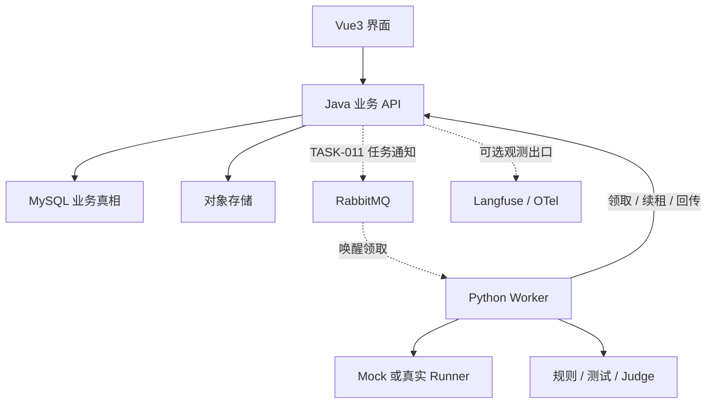

# 系统总体架构

## 技术边界

Java 21 / Spring Boot 模块化单体负责业务与持久化；MyBatis + Flyway 管理 MySQL 8；Python Worker 执行 Agent 和算子；Vue3 / TypeScript 展示业务。具体 Spring Boot、Python、Node 和依赖版本在 TASK-001 读取现有仓库后锁定，禁止盲目升级。MySQL 需支持真实执行 CHECK 约束，8.0 基线最低为 8.0.16；实际部署使用仍受维护的兼容版本并做兼容性测试。

## 组件职责

| 组件 | 负责 | 不负责 |
| --- | --- | --- |
| Java | 配置快照、Run/Job 状态、租约、导入、Trace 持久化、报告、标注 | 直接执行长时间 Agent 子进程 |
| Python | 领取工作、Runner、算子适配、心跳、规范化事件 | 决定实验终态、直接修改 MySQL |
| MySQL | 事务、业务约束、轻量任务领取、结果与元数据 | 大文件正文、日志全文搜索集群 |
| MinIO 或兼容对象存储 | 原始上传文件、大输出、附件 | 持有业务状态 |
| RabbitMQ | TASK-011 后的唤醒通知和至少一次投递 | 唯一任务真相、替代数据库幂等 |
| Langfuse / OTel | 可选可观测性导出与关联 | 本平台结果的唯一存储 |

Worker 在对象存储读写也通过 Java 签发的短期授权或 Java 代理接口，不能获取长期管理员密钥。大文件授权必须限定 object_key、长度、有效期。

## 工程组织

建议 `repopilot-server/`、`repopilot-worker/`、`repopilot-web/`、`deploy/`、`docs/`、`tasks/`。已有 TASK-001 结构优先，目录不同不构成重建理由。

Java 按 agent、dataset、evaluationconfig、experiment、trace、evaluation、annotation、importing 分模块，公共层只存通用组件。Mapper 位于基础设施层，Controller 返回 DTO，事务由业务服务控制。不要一次创建所有空 Controller/Service。

## 调度分期

TASK-004 开始采用短事务数据库领取：选择可执行 Run、创建 Attempt、写租约；Python 在事务提交后执行。TASK-007 对 Job 复用同样机制。TASK-011 的 MQ 消息只携带 ID 和版本，收到后仍经过相同领取校验，数据库轮询保留为恢复通道。

这样 TASK-004 不依赖尚未开发的 TASK-011，也不把租约、重试、幂等等基础正确性拖到最后补救。

## 数据流

在线：发布配置 → 实验锁定版本 → 生成 Run → Worker 执行 → 接受输出和轨迹封口 → 创建 INITIAL 评测批次 → 生成 Job → 算子结果 → 批次/Run/Experiment 聚合。

离线：先有已发布样本 → 创建 OFFLINE 实验 → 导入历史 Run 和事件 → 冻结导入清单 → 创建 INITIAL 评测批次 → 生成同一类 Job → 结果与报告。只有历史执行记录但没有样本时，先把任务输入导成草稿数据集、发布，再绑定历史记录。

重评：选择已封口 Run 与新的已发布方案版本 → 创建新批次（复用 Trace，不执行 Agent） → 新 Job/Result → 与原批次并列对比。

## 运维可见性

至少记录 requestId、experimentId、runId、attemptId、jobId；日志不输出完整输入、密钥或 Judge 原始敏感文本。监控领取延迟、租约过期、重试、待执行数量、导入错误、算子超时和成本缺失率。所有配置默认本地/受控内网。
