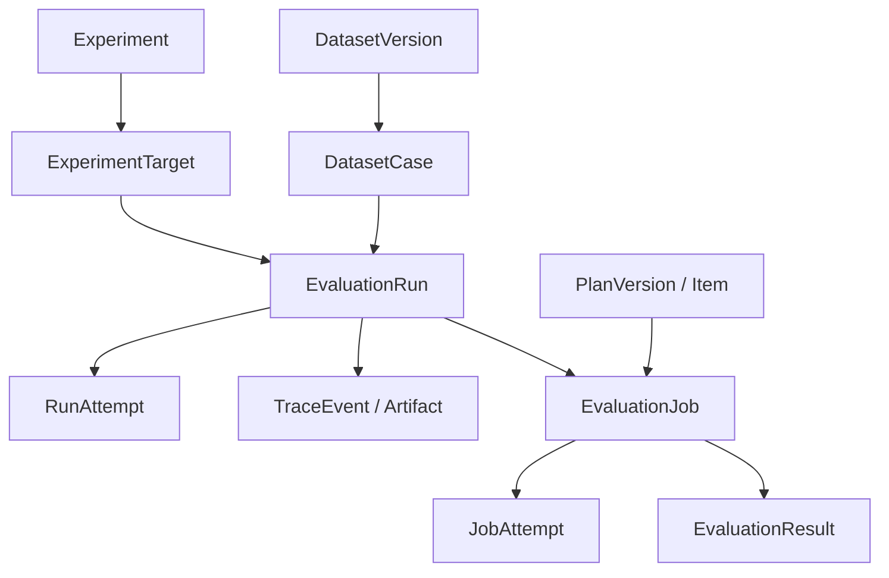

# 领域模型与业务不变量

## 聚合关系

## 核心定义

- Agent 是对象身份；AgentVersion 是不可变执行配置，含 runnerType、模型/网关引用、prompt、工具白名单、超时、适配器版本。密钥仅存 secretRef。
- DatasetVersion 是固定样本集合；DatasetCase 的 case_key 是版本内稳定身份，input_json 必填，expected_json 可缺失。
- EvaluationPlanVersion 是固定算子集合、顺序、参数、required 标志与回归门禁配置；EvaluatorDefinition 也有不可变发布版本。
- Experiment 固定数据集与方案版本，以及 1~N 个 Target。发布版本可被归档但仍可读取，历史实验继续使用快照。
- Run 是一次逻辑观察单位，身份为 `(experiment_target_id, dataset_case_id, repeat_index)`。repeat_index 从 1 开始，不是重试次数。
- RunAttempt 是一次基础设施执行尝试。失败重试增加 Attempt，不增加实验重复样本。成功执行后锁定 accepted_attempt_id，后续算子只读取这个 Attempt 的数据。
- EvaluationJob 对应一个 Run×PlanItem；EvaluationJobAttempt 保存算子尝试；EvaluationResult 每 Job 一份最终结论。

## 数据库与服务层约束分工

| 规则 | 数据库 | 服务层 |
| --- | --- | --- |
| ID、父记录存在、版本号/slot 唯一 | 主外键、UNIQUE | 输入格式校验 |
| repeat_index≥1、score∈[0,1]、计数非负 | CHECK | 明确业务错误码 |
| Run 的 Target 与 Experiment 一致 | 复合外键 | 创建时也校验 |
| Run 的 Case 属于实验数据集版本 | 普通外键不足以表达 | 在同一事务校验，禁止跨数据集引用 |
| 在线 Target 必须有已发布 AgentVersion | agent_version_id 可空 | ONLINE 模式强制校验 |
| 发布版本内容不可修改 | 不用触发器实现业务版本管理 | 更新时锁父版本，校验状态；所有子项写入走同一规则 |
| Trace/Job 的 Attempt 属于当前 Run/Job | 复合外键 | 校验当前租约与状态 |
| 重复 API/回调与内容冲突 | 唯一键、摘要字段 | 同键同摘要复用；同键异摘要返回 409 |

Java 是唯一业务写入入口。发布时与编辑时都锁定同一个版本行，避免“先检查草稿、随后并发发布”的竞态。归档只改生命周期状态，不改版本内容。

## 在线与离线

所有 Run 的 dataset_case_id、experiment_id、target_id 必填，避免报告出现无法配对的记录。离线 Target 的 agent_version_id 可空，但 target_key、display_name 必填。原始 source_system/source_record_id 成对出现；离线必须提供，用于幂等与追溯。

V1 每个 Target 的 repeat_count 定义每个样本的槽位数量，创建在线实验时生成全部槽位；离线记录必须提供 repeatIndex，范围为 1..repeat_count。一个槽位只能导入一条历史记录；同槽位不同来源或不同正文报冲突，不静默覆盖。每个历史日志独立成样本时 case_key 必须区分，不能伪装为同一次重复。

LiteLLM 的单次调用日志默认 task_type=LLM_CALL，只说明一次模型调用，不自动提升为完整 Agent 任务。缺失工具轨迹、ground truth 或成本时保留缺失标记，相关算子返回 NOT_APPLICABLE 或 INDETERMINATE。

## 状态与结论

Run.status 表示执行和评测管道的技术状态。task_outcome 表示任务结果，默认 UNKNOWN；由可信 Runner 的明确任务检查或方案声明的 task_outcome 来源算子决定，不使用 HTTP 200、文字流畅程度或“所有可用算子通过”自动推断成功。

Job.status=COMPLETED + Result.verdict=FAIL 是有效质量失败，不是技术错误。人工判断以独立 annotation_records 追加保存，报告可以选择“机器原始值”或“已审核标注覆盖视图”，不覆盖自动结果。

## V1 可复现性边界

固定数据集、Agent/方案/算子版本与配置摘要，保存模型标识、适配器版本、代码提交或镜像摘要、运行参数、使用的输入与最终输出。外部模型可能变化；无法固定供应商服务内部版本时明确标注，不能承诺完全确定性重现。
