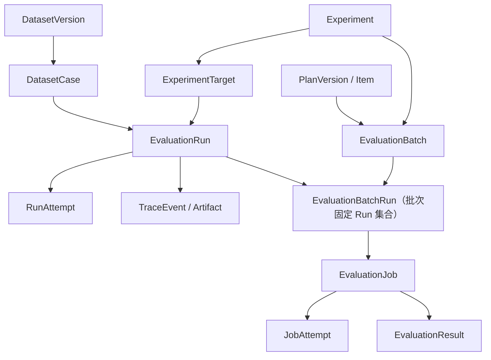

# 领域模型与业务不变量

## 聚合关系

## 核心定义

- Agent 是对象身份；AgentVersion 是不可变执行配置，含 runnerType、模型/网关引用、prompt、工具白名单、超时、适配器版本。密钥仅存 secretRef。
- DatasetVersion 是固定样本集合；DatasetCase 的 case_key 是版本内稳定身份，input_json 必填，expected_json 可缺失。
- EvaluationPlanVersion 是固定算子集合、顺序、参数、required 标志与回归门禁配置；EvaluatorDefinition 也有不可变发布版本。
- Experiment 固定数据集与方案版本，以及 1~N 个 Target。发布版本可被归档但仍可读取，历史实验继续使用快照。
- Run 是一次逻辑观察单位，身份为 `(experiment_target_id, dataset_case_id, repeat_index)`。repeat_index 从 1 开始，不是重试次数。
- RunAttempt 是一次基础设施执行尝试。失败重试增加 Attempt，不增加实验重复样本。成功执行后锁定 accepted_attempt_id，后续算子只读取这个 Attempt 的数据。
- EvaluationBatch 是一次评测批次的身份：固定 `(experiment, planVersion, Run 选择范围)`，可基于历史 Run 重新评测。Run 选择范围在建批次时解析成 `evaluation_batch_runs` 的确定行集合，之后只读；`selection_json` 只保留"当初的选择依据与排除原因"。同一 Run 允许出现在多个批次，历史批次与其结果不可覆盖。
- EvaluationJob 对应批次内一个 Run×PlanItem，且该 Run 必须已登记在本批次；EvaluationJobAttempt 保存算子尝试；EvaluationResult 每 Job 一份最终结论。结果版本由所属批次承载，**不额外引入 `result.version` 自增列**，避免出现两套版本真相。

## 数据库与服务层约束分工

| 规则 | 数据库 | 服务层 |
| --- | --- | --- |
| ID、父记录存在、版本号/slot 唯一 | 主外键、UNIQUE | 输入格式校验 |
| repeat_index≥1、score∈[0,1]、计数非负 | CHECK | 明确业务错误码 |
| Run 的 Target 与 Experiment 一致 | 复合外键 | 创建时也校验 |
| Run 的 Case 属于实验数据集版本 | 普通外键不足以表达 | 在同一事务校验，禁止跨数据集引用 |
| 在线 Target 必须有已发布 AgentVersion | agent_version_id 可空 | ONLINE 模式强制校验 |
| 发布版本内容不可修改 | 不用触发器实现业务版本管理 | 更新时锁父版本，校验状态；所有子项写入走同一规则 |
| Trace/Job 的 Attempt 属于当前 Run/Job | 复合外键 | 校验当前租约与状态 |
| Job 的算子项必须属于该批次的方案版本 | 复合外键：`(batch_id, plan_version_id)` 指向批次、`(plan_version_id, item_id)` 指向方案项 | 创建时校验方案版本已发布 |
| 批次固定了哪些 Run | `evaluation_batch_runs` 主键 `(batch_id, run_id)`，且 Job 的 `(batch_id, run_id)` 指向它 | 建批次时解析选择条件并同事务写入，之后拒绝增删 |
| 批次与 Run 属于同一 Experiment | 关联表的 `experiment_id` 快照列同时参与两条复合外键 | 创建前再校验并以明确错误码返回 |
| 父批次与子批次同实验 | 复合外键 `(parent_batch_id, experiment_id)` | 同上 |
| 同一 Run 在同一批次同一算子项只能有一个 Job | UNIQUE `(batch_id, run_id, plan_item_id)` | 返回资源冲突，不静默复用 |
| 重复 API/回调与内容冲突 | 唯一键、摘要字段 | 同键同摘要复用；同键异摘要返回 409 |

Java 是唯一业务写入入口。发布时与编辑时都锁定同一个版本行，避免“先检查草稿、随后并发发布”的竞态。归档只改生命周期状态，不改版本内容。

## 评测批次与重评

评测与 Agent 执行是两个可独立重放的过程。**重新评测不得重新执行 Agent**：Agent 已产生的 Run、accepted Attempt 与封口 Trace 保持不变，只新增评测批次。

| 触发类型 | 创建时机 | Run 选择范围 |
| --- | --- | --- |
| INITIAL | 实验开始时由后端创建，默认批次 | 实验内全部槽位 |
| REEVALUATION | 负责人升级 Judge / 规则算子或方案后主动重评 | 显式 runIds 或按 status/target/时间过滤，写入 selection_json |
| MANUAL | 补评、返工或修复个别 Job | 显式 runIds |

规则：

1. 批次固定一个**已发布** EvaluationPlanVersion；重评使用新版本时创建新批次，`parent_batch_id` 指向被重评批次（必须同实验），便于对比"同一批 Run 在两版算子下的结果"。
2. `batch_no` 在实验内递增；历史批次只读，不修改其方案版本、Run 集合或已产生的 Job/Result。批次的 Run 集合落库为 `evaluation_batch_runs` 的确定行，不是查询时动态过滤。
3. 同一 Run 在不同批次可以再次评测；同一批次内同一 Run×方案项最多一个 Job。Job 重试仍只增加 JobAttempt，不新建 Job。
4. 批次状态不反向改变 Experiment.status。Experiment.status 只描述执行管道与初始批次；重评失败不应把历史实验改写成 PARTIAL_FAILED。每个批次有独立的 PENDING/RUNNING/COMPLETED/PARTIAL_FAILED/FAILED/CANCELLED，即使初始批次早已完成，新批次仍可 RUNNING 或 FAILED。
5. 报告与对比的批次**默认值固定**：不传批次参数时返回初始批次；"最新评测"必须显式 `batchScope=LATEST`，其语义是**最新创建**的批次，包含 RUNNING/FAILED，不静默回退到上一个成功批次；指定批次用 `batchId`。响应回显实际使用的 batchId、batchScope 与 batchStatus，禁止"看起来是旧数据、实际是新结果"。
6. 没有 Run 的批次不允许创建；`expected_job_count` 在创建 Job 前冻结，用于判断批次是否完整。
7. 在线与离线共用同一批次、Job、Attempt、Result 链路；离线 Run 只是缺少 RunAttempt，不另建评测表。
8. **每个实验最多一个 INITIAL 批次**，由 `evaluation_batches.initial_experiment_id` 生成列上的唯一键在数据库层保证：并发创建两个初始批次时，后到者拿到重复键错误，而不是靠先查后插。重评与补评一律使用 `REEVALUATION` 或 `MANUAL`。

## 在线与离线

所有 Run 的 dataset_case_id、experiment_id、target_id 必填，避免报告出现无法配对的记录。离线 Target 的 agent_version_id 可空，但 target_key、display_name 必填。原始 source_system/source_record_id 成对出现；离线必须提供，用于幂等与追溯。

V1 每个 Target 的 repeat_count 定义每个样本的槽位数量，创建在线实验时生成全部槽位；离线记录必须提供 repeatIndex，范围为 1..repeat_count。一个槽位只能导入一条历史记录；同槽位不同来源或不同正文报冲突，不静默覆盖。每个历史日志独立成样本时 case_key 必须区分，不能伪装为同一次重复。

LiteLLM 的单次调用日志默认 task_type=LLM_CALL，只说明一次模型调用，不自动提升为完整 Agent 任务。缺失工具轨迹、ground truth 或成本时保留缺失标记，相关算子返回 NOT_APPLICABLE 或 INDETERMINATE。

### 离线导入与样本归属（V1 冻结）

V1 不允许游离 Run：每个 EvaluationRun 必须有 `dataset_case_id`。历史记录本身没有 case_id 时，导入链路按以下顺序补齐归属，**不改动 Run 表结构**：

1. 选定目标数据集并创建/复用一个**草稿** DatasetVersion；
2. 由规范化输入推导稳定 `case_key`（来源系统 + 来源记录标识，或输入正文摘要；大小写敏感、可复算、不得随机生成）；
3. 在该草稿版本内生成 DatasetCase：`input_json` 取自记录正文，`expected_json` 在原始记录没有参考答案时保持 NULL；
4. 人工检查后发布该版本；
5. `OFFLINE_RUNS` 导入时，`caseKey` 必须命中已发布版本的既有样本，命中后建立 Run 与样本的关联；
6. 关联完成的 Run 进入统一评测引擎。

自动生成 DatasetCase **不等于补造标准答案**：不得写占位 `expected_json`、不得伪造 `task_outcome=SUCCESS`、不得生成不存在的工具轨迹。缺少 Ground Truth 时依赖答案的算子返回 `NOT_APPLICABLE`；缺少工具观测时 `trace.tool_error` 返回 `NOT_APPLICABLE` 而不是 PASS。

自动生成只发生在 `DATASET_CASES` 导入阶段（目标是草稿版本）。`OFFLINE_RUNS` 阶段不得向已发布数据集插入样本：命中失败的行整体拒绝并写 `import_error`，不静默新建样本。

## 状态与结论

Run.status 表示执行和评测管道的技术状态。task_outcome 表示任务结果，默认 UNKNOWN；由可信 Runner 的明确任务检查或方案声明的 task_outcome 来源算子决定，不使用 HTTP 200、文字流畅程度或“所有可用算子通过”自动推断成功。

Job.status=COMPLETED + Result.verdict=FAIL 是有效质量失败，不是技术错误。人工判断以独立 annotation_records 追加保存，报告可以选择“机器原始值”或“已审核标注覆盖视图”，不覆盖自动结果。

## V1 可复现性边界

固定数据集、Agent/方案/算子版本与配置摘要，保存模型标识、适配器版本、代码提交或镜像摘要、运行参数、使用的输入与最终输出。外部模型可能变化；无法固定供应商服务内部版本时明确标注，不能承诺完全确定性重现。
